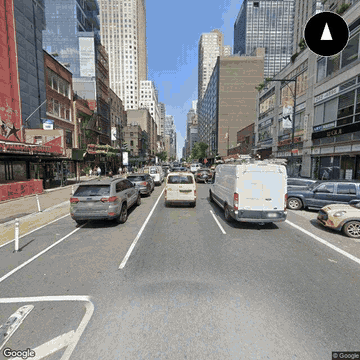
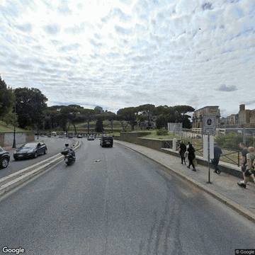
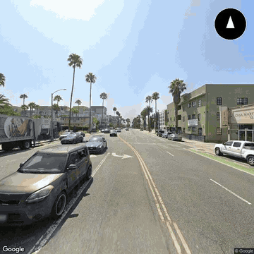
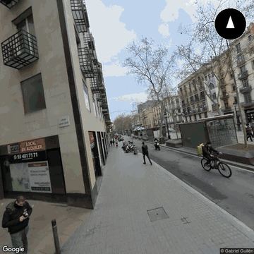
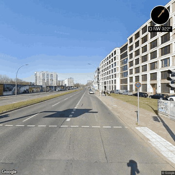

# 🎬 Street View to Video

Transform any route into a cinematic Street View journey! Enter a start and end location, and this app creates a smooth video by stitching together Google Street View images along the path.

There's no hosted demo right now; it runs locally with your own Google API key (see [Quick Start](#-quick-start)).


---

## 🎥 Example Videos

<table>
<tr>
<td align="center">
<strong>🗽 Times Square → Central Park (NYC)</strong><br/>
<a href="https://github.com/aldrinjenson/street-view-to-video/releases/download/v1.0-examples/nyc-times-square-to-central-park.mp4"></a><br/>
<a href="https://github.com/aldrinjenson/street-view-to-video/releases/download/v1.0-examples/nyc-times-square-to-central-park.mp4">▶️ Full video (MP4)</a>
</td>
<td align="center">
<strong>🏛️ Colosseum → Trevi Fountain (Rome)</strong><br/>
<a href="https://github.com/aldrinjenson/street-view-to-video/releases/download/v1.0-examples/rome-colosseum-to-trevi-fountain.mp4"></a><br/>
<a href="https://github.com/aldrinjenson/street-view-to-video/releases/download/v1.0-examples/rome-colosseum-to-trevi-fountain.mp4">▶️ Full video (MP4)</a>
</td>
</tr>
<tr>
<td align="center">
<strong>🏖️ Santa Monica → Venice Beach (LA)</strong><br/>
<a href="https://github.com/aldrinjenson/street-view-to-video/releases/download/v1.0-examples/la-santa-monica-to-venice-beach.mp4"></a><br/>
<a href="https://github.com/aldrinjenson/street-view-to-video/releases/download/v1.0-examples/la-santa-monica-to-venice-beach.mp4">▶️ Full video (MP4)</a>
</td>
<td align="center">
<strong>🌳 Las Ramblas → Barcelona Cathedral</strong><br/>
<a href="https://github.com/aldrinjenson/street-view-to-video/releases/download/v1.0-examples/barcelona-las-ramblas-to-cathedral.mp4"></a><br/>
<a href="https://github.com/aldrinjenson/street-view-to-video/releases/download/v1.0-examples/barcelona-las-ramblas-to-cathedral.mp4">▶️ Full video (MP4)</a>
</td>
</tr>
<tr>
<td align="center">
<strong>🇩🇪 East Side Gallery → Alexanderplatz (Berlin)</strong><br/>
<a href="https://github.com/aldrinjenson/street-view-to-video/releases/download/v1.0-examples/berlin-east-side-gallery-to-alexanderplatz.mp4"></a><br/>
<a href="https://github.com/aldrinjenson/street-view-to-video/releases/download/v1.0-examples/berlin-east-side-gallery-to-alexanderplatz.mp4">▶️ Full video (MP4)</a>
</td>
<td></td>
</tr>
</table>

> 💡 *Previews are 6-second GIFs; click for the full MP4. Most routes were captured every 15 m and rendered at 15 FPS (Santa Monica at 18 FPS; Barcelona re-rendered at 6 FPS from its 65 frames). All videos are on the [v1.0-examples release](https://github.com/aldrinjenson/street-view-to-video/releases/tag/v1.0-examples).*

---

## ✨ Features

| Feature | Description |
|---------|-------------|
| 🗺️ **Interactive Map** | See your route preview before generating |
| 📍 **Place Autocomplete** | Smart search with Google Places API |
| 🧭 **Direction Compass** | Shows heading direction in each frame |
| 🎵 **Background Music** | Add ambient music to your videos |
| 🎚️ **Customizable** | Adjust FPS, interval, FOV, pitch |
| 💰 **Cost Tracking** | Know your API costs upfront |
| 📁 **Project Gallery** | View and manage all your generated videos |
| 🌍 **20+ Preset Routes** | Popular walking tours worldwide |

---

## 🌍 Preset Routes

Choose from famous walking tours around the world:

- 🗽 **New York**: Times Square → Central Park, Greenwich Village Walk
- 🌉 **San Francisco**: Golden Gate Bridge, Lombard St → Pier 39
- 🏖️ **Los Angeles**: Santa Monica → Venice Beach
- 🗼 **Paris**: Eiffel Tower → Arc de Triomphe, Left Bank Walk
- 🏛️ **Rome**: Colosseum → Trevi Fountain
- 🌸 **Tokyo**: Shibuya → Tokyo Tower, Harajuku Walk
- 🎡 **London**: London Eye → Big Ben, Covent Garden
- 🇩🇪 **Berlin**: Brandenburg Gate → Checkpoint Charlie
- 🏰 **Prague**: Charles Bridge → Prague Castle
- 🎰 **Las Vegas**: Full Vegas Strip Experience
- And many more!

---

## 🚀 Quick Start

### Prerequisites

1. **Python 3.9+**
2. **FFmpeg** - Required for video creation
   ```bash
   # macOS
   brew install ffmpeg
   
   # Ubuntu/Debian
   sudo apt install ffmpeg
   
   # Windows (with chocolatey)
   choco install ffmpeg
   ```

3. **Google API Key** with these APIs enabled:
   - Geocoding API
   - Directions API
   - Street View Static API
   - Places API (for autocomplete)

### Installation

```bash
# Clone the repository
git clone https://github.com/aldrinjenson/street-view-to-video.git
cd street-view-to-video

# Create virtual environment
python -m venv venv
source venv/bin/activate  # On Windows: venv\Scripts\activate

# Install dependencies
pip install -r requirements.txt
```

### Configuration

Create a `.env` file in the project root:

```env
GOOGLE_API_KEY=your_api_key_here
```

### Run the App

```bash
streamlit run app_enhanced.py
```

The app will open at `http://localhost:8501`

---

## 🎮 Usage

1. **Select a Route** - Choose from preset routes or enter custom locations
2. **Adjust Settings** in the sidebar:
   - 📏 Image interval (meters between captures)
   - 🎬 Video FPS (frames per second)
   - 📷 Camera field of view
   - ⬆️ Camera pitch (up/down angle)
   - 🧭 Direction overlays
   - 🎵 Background music
3. **Generate** - Click "🚀 Generate Video"
4. **Preview & Download** - Watch your video and download it!

---

## 💰 Cost Information

Google Street View Static API pricing:
- **$7.00 per 1,000 requests**
- **$200/month free credit** (~28,500 free images)

| Route Length | Images @15m | Est. Cost |
|--------------|-------------|-----------|
| 1 km         | 67          | ~$0.47    |
| 2 km         | 134         | ~$0.94    |
| 5 km         | 334         | ~$2.34    |

Most personal projects stay within the free tier! The app shows exact cost for each video.

---

## 🗂️ Project Structure

```
street_view_to_video/
├── app_enhanced.py       # Main Streamlit application
├── regenerate_video.py   # CLI tool to recreate videos
├── requirements.txt      # Python dependencies
├── packages.txt          # System dependencies (FFmpeg)
├── .env                  # Your API key (not in git)
├── .streamlit/           # Streamlit configuration
├── audio_samples/        # Background music files
└── projects/             # Generated videos and images
    └── <route_timestamp>/
        ├── images/       # Street View frames
        ├── video.mp4     # Generated video
        └── metadata.json # Route and cost info
```

---

## 🛠️ CLI Tools

Regenerate videos from existing image sets:

```bash
# List all projects
python regenerate_video.py --list

# Regenerate with new settings
python regenerate_video.py --project <project_id> --fps 30

# Add music to existing video
python regenerate_video.py --project <project_id> --audio audio_samples/calm_journey.mp3
```

---

## ☁️ Deploy to Streamlit Cloud

1. Fork this repository
2. Go to [share.streamlit.io](https://share.streamlit.io)
3. Connect your GitHub and select this repo
4. Set `app_enhanced.py` as the main file
5. Add your `GOOGLE_API_KEY` in Secrets
6. Deploy!

---

## ⚠️ Limitations

- Max image resolution: 640x640 pixels
- Some areas may have sparse Street View coverage
- Rural/private roads may not have imagery
- Cloud deployment: videos are temporary (download them!)

---

## 🤝 Contributing

Contributions welcome! Feel free to:
- Add new preset routes
- Improve the UI
- Add new features
- Fix bugs

---

## 📝 License

MIT License - Use freely for personal and commercial projects!

---

<div align="center">

Made with ❤️ using Google Street View API & Streamlit

**[⭐ Star this repo](https://github.com/aldrinjenson/street-view-to-video)** if you find it useful!

</div>
